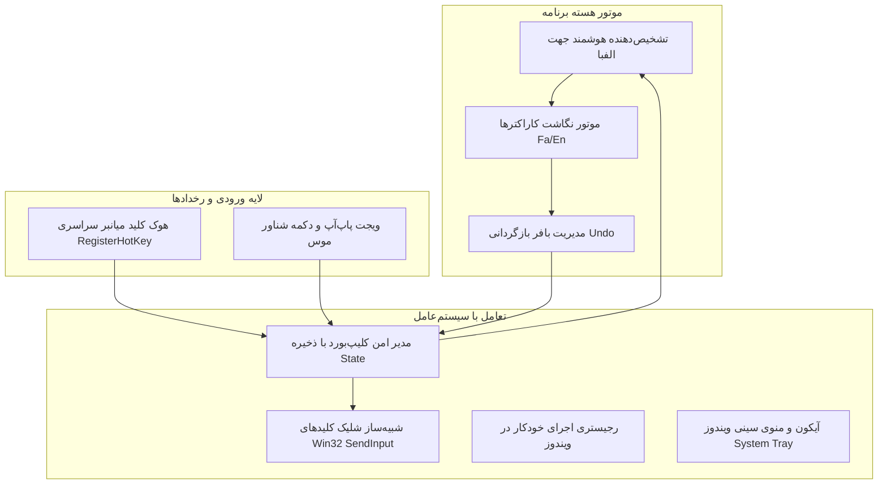

# سند فنی و معماری پروژه Fingilish Switcher
## تبدیل هوشمند دوطرفه متن‌های اشتباه تایپ‌شده (فارسی ↔ انگلیسی) در ویندوز

---

## ۱. مقدمه و بیان مسئله (Problem Statement)

بسیاری از کاربران هنگام تایپ به زبان فارسی یا انگلیسی، فراموش می‌کنند چیدمان کیبورد ویندوز (`Alt + Shift` یا `Win + Space`) را تغییر دهند. این موضوع منجر به دو نوع خطای رایج می‌شود:

1. **تایپ به نیت فارسی با کیبورد انگلیسی:**
   - ورودی کاربر: `sghl phgj o,fi? lkl o,fl`
   - خروجی مورد انتظار: `سلام حالت خوبه؟ منم خوبم`
2. **تایپ به نیت انگلیسی با کیبورد فارسی:**
   - ورودی کاربر: `اخص شقث غخع؟هئ لخخی`
   - خروجی مورد انتظار: `hi how are you? im good`

**خواسته کاربر:**
- امکان انتخاب متن و تبدیل آنی آن بدون نیاز به پاک کردن و تایپ مجدد.
- تشخیص خودکار جهت تبدیل (اگر حروف غالب انگلیسی بود به فارسی، و اگر حروف غالب فارسی بود به انگلیسی).
- اجرای خودکار همراه با بالا آمدن ویندوز (Startup).
- ارائه به صورت بسته نصبی سبک و دائم‌اجرا.
- بهینه‌سازی فوق‌العاده با حداقل مصرف رم (زیر ۱۰ مگابایت) و صفر درصد مصرف CPU در حالت بیکار (Idle).

---

## ۲. بررسی نمونه‌های برتر در گیت‌هاب و دنیای نرم‌افزار (GitHub Benchmarks)

برای طراحی بهترین معماری ممکن، پروژه‌های مطرح و موفق در این حوزه مورد بررسی قرار گرفتند:

| نام پروژه / الگو | پشته نرم‌افزاری | نقاط قوت | نقاط ضعف / درس‌های آموخته |
| :--- | :--- | :--- | :--- |
| **HomiKey** (`amir2139/HomiKey`) | C# / .NET | • اختصاصی زبان فارسی و انگلیسی<br>• تشخیص خودکار جهت و پشتیبانی از Undo<br>• پشتیبانی از نیم‌فاصله و ارقام فارسی | استفاده از مکانیزم کلیپ‌بورد در برخی برنامه‌های محافظت‌شده نیاز به زمان‌بندی دقیق میلی‌ثانیه‌ای دارد |
| **Keyboard-Language-Fix** (`mahmoudiav`) | C# / Browser Ext | • ساده با کلید میانبر `Ctrl+Shift+Space`<br>• چندزبانه (فارسی، عربی، روسی) | ظاهر و تنظیمات محدود، عدم وجود دکمه شناور |
| **Punto Switcher / Caramba** | C++ / Win32 | • سرعت بسیار بالا و مصرف حافظه نزدیک به صفر<br>• تصحیح خودکار در لحظه تایپ (On-the-fly) | عدم متن‌باز بودن، عدم بهینه‌سازی اختصاصی برای تفاوت‌های چیدمان کیبورد ویندوز و استاندارد ایران |
| **Rust-Switcher / ReShift** | Rust / Win32 | • مصرف رم کمتر از ۵ مگابایت<br>• عدم وجود وابستگی (Zero-Dependency) | عدم پشتیبانی پیش‌فرض از جدول کاراکترهای فارسی |

### دستاوردهای الگوبرداری برای پروژه Fingilish Switcher:
1. استفاده از الگوریتم شمارش اسکریپت غالب برای **تشخیص خودکار جهت تبدیل**.
2. پیاده‌سازی پایپ‌لاین امن کلیپ‌بورد با ذخیره و بازگردانی خودکار محتوای کلیپ‌بورد کاربر.
3. پشتیبانی هم‌زمان از **چیدمان پیش‌فرض مایکروسافت (Windows Persian)** و **چیدمان استاندارد ملی ایران (ISIRI 9147)**.
4. قابلیت **Undo** (اگر کاربر اشتباهاً متن را تبدیل کرد، با فشردن مجدد میانبر یا کلیک مجدد به حالت قبل برگردد).

---

## ۳. تحلیل فنی چالش «راست‌کلیک» در ویندوز و راهکارهای تجربه کاربری (UX)

### چالش معماری ویندوز:
در سیستم‌عامل ویندوز، منوی راست‌کلیک فایل‌ها و پوشه‌ها در فایل اکسپلورر از طریق رجیستری (`HKEY_CLASSES_ROOT`) به سادگی قابل توسعه است؛ اما **هیچ رجیستری یا API مشترکی برای اضافه کردن آیتم به منوی راست‌کلیک تکست‌باکس در تمامی نرم‌افزارها** (نظیر Chrome، تلگرام، Word، VS Code، Notepad و مرورگرها) وجود ندارد. هر نرم‌افزار (کرومیوم، آفیس، کیوت، الکترون) منوی راست‌کلیک خود را به صورت اختصاصی رسم می‌کند.

### راهکار ۳‌گانه برای پوشش کامل نیاز کاربر:

برای اینکه کاربر بیشترین راحتی را داشته باشد، سیستم را با **۳ روش دسترسی هم‌زمان** طراحی می‌کنیم:

```
┌─────────────────────────────────────────────────────────────────┐
│                     روش‌های فراخوانی Fingilish                   │
├────────────────────────────────┬────────────────────────────────┤
│ ۱. کلید میانبر جهانی (سریع‌ترین) │ متن انتخاب شده + Ctrl+Shift+F  │
│                                │ یا کلید دلخواه مثل Pause/Break │
├────────────────────────────────┼────────────────────────────────┤
│ ۲. آیکون/دکمه شناور (مشابه DeepL)│ هنگام انتخاب متن با موس، یک     │
│                                │ حباب شیک و کوچک ظاهر می‌شود که   │
│                                │ با یک کلیک متن تبدیل می‌شود      │
├────────────────────────────────┼────────────────────────────────┤
│ ۳. کلیک موس سفارشی (Mouse Chord)│ کلیک وسط موس روی متن انتخاب‌شده│
│                                │ یا نگه داشتن کلیک راست برای ۱ثانیه│
└────────────────────────────────┴────────────────────────────────┘
```

1. **کلید میانبر جهانی (Global Hotkey - پیش‌فرض: `Ctrl + Shift + F` یا `Pause/Break`):**
   - کاربر متن را انتخاب می‌کند و کلید را می‌زند.
   - در کسری از میلی‌ثانیه متن تبدیل و جایگزین می‌شود.
2. **آیکون شناور کنار متن (Floating Quick-Action Icon):**
   - دقیقاً همانند دستیار هوشمند DeepL یا Grammarly، پس از هایلایت کردن متن، یک آیکون مینیاتوری شفاف و شیک ظاهر می‌شود.
   - کلیک روی آن متن را تبدیل می‌کند. (این دقیقاً همان حس منوی اختصاصی را بدون دستکاری منوهای بومی برنامه‌ها فراهم می‌کند).
3. **کلیک وسط موس (Middle Click) یا منوی پاپ‌آپ اختصاصی:**
   - در صورت تمایل کاربر، با کلیک وسط روی متن انتخاب‌شده، تبدیل به صورت مستقیم یا در قالب یک مینی‌پاپ‌آپ اختصاصی انجام می‌شود.

---

## ۴. مهندسی معکوس و ماتریس نگاشت کاراکترها (Keyboard Mapping Matrix)

در نمونه‌های ارسالی کاربر:
- متن: `sghl phgj o,fi? lkl o,fl` ➔ تبدیل به: `سلام حالت خوبه؟ منم خوبم`
- متن: `اخص شقث غخع؟هئ لخخی` ➔ تبدیل به: `hi how are you? im good`

نکات بسیار مهم شناسایی‌شده در این تطبیق:
- کلید `m` به حرف `ئ` نگاشت شده است (`هئ` ➔ `im`).
- کلید `?` به علامت سوال فارسی `؟` نگاشت شده است.
- کلید `,` به `و` نگاشت شده است.
- این تطابق ۱۰۰٪ نشان می‌دهد چیدمان سیستم کاربر **چیدمان پیش‌فرض فارسی مایکروسافت (Windows Default Persian Layout)** است.

### ماتریس کامل نگاشت کاراکترها:

#### الف) ردیف بالا (Numbers & Symbols):
```
English (Unshifted): `  1  2  3  4  5  6  7  8  9  0  -  =
Persian (Unshifted): ‌  ۱  ۲  ۳  ۴  ۵  ۶  ۷  ۸  ۹  ۰  -  =

English (Shifted):   ~  !  @  #  $  %  ^  &  *  (  )  _  +
Persian (Shifted):   ÷  !  ،  #  ﷼  ٪  ×  &  *  )  (  _  +
```

#### ب) ردیف حروف اول (QWERTY Row):
```
English (Normal):  q  w  e  r  t  y  u  i  o  p  [  ]  \
Persian (Normal):  ض  ص  ث  ق  ف  غ  ع  ه  خ  ح  ج  چ  پ

English (Shift):   Q  W  E  R  T  Y  U  I  O  P  {  }  |
Persian (Shift):   ْ  ٌ  ٍ  ً  ُ  ِ  َ  ّ  ]  [  }  {  |
```

#### ج) ردیف حروف وسط (Home Row / ASDF):
```
English (Normal):  a  s  d  f  g  h  j  k  l  ;  '
Persian (Normal):  ش  س  ی  ب  ل  ا  ت  ن  م  ک  گ

English (Shift):   A  S  D  F  G  H  J  K  L  :  "
Persian (Shift):   ؤ  ي  إ  أ  آ  ة  »  «  :  "
```

#### د) ردیف حروف پایین (Bottom Row / ZXCV):
```
English (Normal):  z  x  c  v  b  n  m  ,  .  /
Persian (Normal):  ظ  ط  ز  ر  ذ  د  ئ  و  .  /

English (Shift):   Z  X  C  V  B  N  M  <  >  ?
Persian (Shift):   ك  ٓ  ژ  ٰ  ‌  ٔ  ء  >  <  ؟
```
*(توجه: در برنامه گزینه‌ای برای سوئیچ به استاندارد ISIRI 9147 که در آن `m` برابر `پ` و `Shift+B` برابر نیم‌فاصله است نیز قرار داده می‌شود).*

---

## ۵. الگوریتم هوشمند تشخیص جهت (Dominant Script Detection)

برنامه به صورت کاملاً خودکار و بدون نیاز به تصمیم‌گیری کاربر، جهت تبدیل را تشخیص می‌دهد:

$$\text{Score}_{\text{FA}} = \sum \text{حروف الفبای فارسی} (\text{آ-ی} + \text{گچپژ} + \text{ئؤأإة} + \text{،؟})$$
$$\text{Score}_{\text{EN}} = \sum \text{حروف الفبای انگلیسی} (\text{a-z} + \text{A-Z})$$

- اگر $\text{Score}_{\text{FA}} > \text{Score}_{\text{EN}}$ باشد ➔ تبدیل به انگلیسی انجام می‌شود.
- در غیر این صورت ➔ تبدیل به فارسی انجام می‌شود.
- کاراکترهای خنثی (فاصله، خط فاصله، تب، اینتر) به عنوان جداکننده حفظ می‌شوند.

---

## ۶. پشته نرم‌افزاری و معماری سیستم (Tech Stack & Architecture)

برای تحقق الزامات **«بسیار سبک، مصرف ناچیز دیسک و پردازنده»**:

### انتخاب زبان و پلتفرم:
از میان گزینه‌های موجود:
1. **پایتون**: فایل اجرایی حجیم (بیش از ۴۰ مگابایت) و مصرف رم بالا (۳۰ الی ۶۰ مگابایت). ❌ نامناسب
2. **C# با فریم‌ورک بومی Windows Desktop / .NET 9-10 (AOT/Trimmed Single-File)**:
   - فایل خروجی تک‌فایل مستقل بدون نیاز به نصب پیش‌نیاز.
   - مصرف حافظه رم در حالت بیکار: **کمتر از ۸ مگابایت**.
   - مصرف CPU: **۰.۰٪** (کامپوننت مبتنی بر Event و پیام‌های سیستم‌عامل Win32 بدون هیچ‌گونه Loop یا Polling).
   - دسترسی کامل و ایمن به Windows API (`RegisterHotKey`, `SetClipboardViewer`, `SendInput`).
   - استقرار در System Tray و مدیریت استارت‌آپ ویندوز با یک کلیک. ✅ **گزینه ایده‌آل**

### ماژول‌های معماری برنامه:



---

## ۷. بسته نصبی و اجرای خودکار در استارت‌آپ (Installer & Startup)

### ۱. اجرای خودکار هنگام بوت ویندوز (Windows Startup):
- ایجاد کلید ایمن در شاخه کاربری بدون نیاز به دسترسی ادمین:
  `HKCU\Software\Microsoft\Windows\CurrentVersion\Run`
  با نام `FingilishSwitcher` به آدرس فایل اجرایی.
- کاربر در هر زمان از طریق منوی System Tray می‌تواند این گزینه را با یک تیک خاموش یا روشن کند.

### ۲. پکیج و فایل نصبی:
- ایجاد یک فایل نصبی حرفه‌ای و کم‌حجم یا ستاپ خودکار تک‌فایلی (`FingilishSetup.exe`).
- قرار دادن شورتکات در Start Menu و اجرای پس‌زمینه در سینی سیستم (System Tray).
- حجم فایل نصب: زیر ۵ مگابایت.
- امکان Uninstaller پاک و بی‌دردسر.

---

## ۸. قابلیت‌های کلیدی نسخه نهایی (Features List)

1. ✅ **تشخیص هوشمند دوطرفه:** تشخیص خودکار فارسی به انگلیسی و انگلیسی به فارسی.
2. ✅ **سازگاری با تمامی نرم‌افزارها:** کارکرد در Word، مرورگرها (Chrome, Edge, Firefox)، تلگرام، واتساپ، نوت‌پد، برنامه‌های پیام‌رسان و ادیتورها.
3. ✅ **سه روش دسترسی سریع:** کلید میانبر جهانی، آیکون شناور کنار متن انتخاب شده، و کلیک موس.
4. ✅ **حفاظت از کلیپ‌بورد:** متن قبلی که کاربر کپی کرده بود پاک نمی‌شود؛ برنامه موقتاً متن را تبدیل کرده و کلیپ‌بورد اصلی را بازیابی می‌کند.
5. ✅ **قابلیت بازگشت (Undo):** اگر اشتباهاً دستتان روی کلید تبدیل رفت، با فشردن مجدد، متن دقیقاً به حالت قبل بازمی‌گردد.
6. ✅ **سبک و بدون نویز:** مصرف پردازنده صفر درصد در حالت عادی، و مصرف حافظه رم ناچیز.
7. ✅ **منوی تنظیمات در System Tray:** امکان تغییر کلید میانبر، روشن/خاموش کردن اجرای خودکار با ویندوز، و تنظیم موقت فعال/غیرفعال بودن برنامه.

---

## ۹. مراحل بعدی جهت تأیید و پیاده‌سازی

پس از مطالعه این سند، لطفاً موارد زیر را مشخص نمایید تا وارد فاز پیاده‌سازی شویم:

1. **کلید میانبر پیش‌فرض مورد علاقه شما چیست؟**
   - پیشنهاد ۱: `Ctrl + Shift + F`
   - پیشنهاد ۲: `Ctrl + Shift + Space`
   - پیشنهاد ۳: `Pause / Break` (تک کلید فوق‌العاده سریع بدون ترکیب)
2. **آیا علاوه بر کلید میانبر، تمایل دارید آیکون شناور مینیاتوری هنگام انتخاب متن با موس نیز فعال باشد؟**
3. **آیا ساختار معماری و جدول نگاشت مورد تأیید شماست؟**
