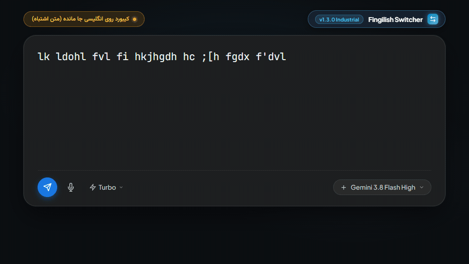

<p align="center">
  <strong>🌐 Seleccionar idioma:</strong> &nbsp;
  <a href="README.md">🇺🇸 English</a> &nbsp;|&nbsp;
  <a href="README.fa.md">🇮🇷 فارسی</a> &nbsp;|&nbsp;
  <a href="README.ru.md">🇷🇺 Русский</a> &nbsp;|&nbsp;
  <a href="README.es.md"><strong>🇪🇸 Español</strong></a> &nbsp;|&nbsp;
  <a href="README.ko.md">🇰🇷 한국어</a>
</p>

# Fingilish Switcher — Edición Políglota y Hangul (v1.5.0) ⚡
### Conversor ultrarrápido, de código abierto y 100% sin conexión para texto escrito con la distribución de teclado incorrecta en Windows

[](https://github.com/yekaweb/fingilish-switcher/releases/tag/v1.5.0)
[-38bdf8.svg)](https://github.com/yekaweb/fingilish-switcher)
[](https://github.com/yekaweb/fingilish-switcher)
[](https://github.com/yekaweb/fingilish-switcher)
[](https://github.com/yekaweb/fingilish-switcher/blob/main/inno/license.txt)

<p align="center">
  
</p>

---

## 1. Descripción general

¿Alguna vez has escrito una frase entera y luego te diste cuenta de que tenías el teclado configurado en otro idioma (`Alt + Shift`)?

* **Inglés ➔ Español:** `espa;ol` ➔ **español** | `=Como estas+` ➔ **¿Como estas¡**
* **Inglés ➔ Ruso (JCUKEN):** `ghbdtn! rfr ltkf?` ➔ **привет! как дела?**
* **Inglés ➔ Coreano (Autómata Hangul 2-Set):** `gksrnr` ➔ **한국** | `tkfkd` ➔ **사랑**
* **Inglés ➔ Persa:** `sghl` ➔ **سلام**
* **Persa ➔ Inglés:** `اخص شقث غخع؟هئ لخخی` ➔ **how are you?im good**

**Fingilish Switcher** es una herramienta de escritorio ligera y profesional para Windows 10 y 11. Simplemente selecciona el texto mal escrito en **cualquier aplicación** (navegadores, chats de IA, Telegram, Word, VS Code, Bloc de notas), presiona **`Ctrl + Shift + F`** (o haz clic en la burbuja flotante **`⇄`**) y el texto se transformará instantáneamente en su lugar.

---

## 2. Características principales de la v1.5.0

1. **🇪🇸 Soporte para teclado Español:** Conversión bidireccional de caracteres especiales como `ñ`, `Ñ`, tildes y signos de interrogación/exclamación invertidos (`¿`, `¡`).
2. **🌐 Detección automática de idiomas de Windows (`GetKeyboardLayoutList`):** Descubre automáticamente todos los idiomas de teclado activos en tu sistema operativo sin configuración manual.
3. **🔄 Cambio cíclico multilingüe (Cycle Morphing):** Si tienes 3 o más idiomas instalados, presionar `Ctrl + Shift + F` nuevamente en menos de 3.5 segundos alterna el texto entre todos tus idiomas activos (`EN ➔ ES ➔ RU ➔ KO ➔ FA`).
4. **🇰🇷 Autómata matemático Hangul (Coreano 2-Set):** Composición y descomposición exacta de bloques silábicos coreanos según la fórmula estándar Unicode (`gksrnr` ↔ `한국`).
5. **⚡ Motor de portapapeles nativo Win32:** Llamadas directas a Win32 API para un rendimiento instantáneo y estable en cualquier software.
6. **🖱️ Burbuja flotante inteligente (`WS_EX_NOACTIVATE`):** Aparece únicamente al seleccionar texto arrastrando el ratón y nunca roba el foco de tu ventana activa.
7. **🔒 100% sin conexión y privado:** Sin telemetría, sin registro de pulsaciones (zero keylogging), menos de 15 MB de RAM y **0.0% de CPU** en reposo.

---

## 3. Descarga e instalación

Descarga el instalador oficial de 64 bits para Windows desde [GitHub Releases (v1.5.0)](https://github.com/yekaweb/fingilish-switcher/releases/tag/v1.5.0):
* Instalador: **`FingilishSwitcher_Setup_v1.5.0.exe`**

---

## 4. Compilar desde el código fuente

```bash
# Compilar versión Release
dotnet build src/FingilishSwitcher -c Release

# Ejecutar pruebas automatizadas (43 pruebas verificadas)
dotnet run --project tests/FingilishTests
```

---

## 5. Licencia

Distribuido bajo la [Licencia MIT](inno/license.txt) — completamente gratuito y de código abierto para uso personal y comercial.
