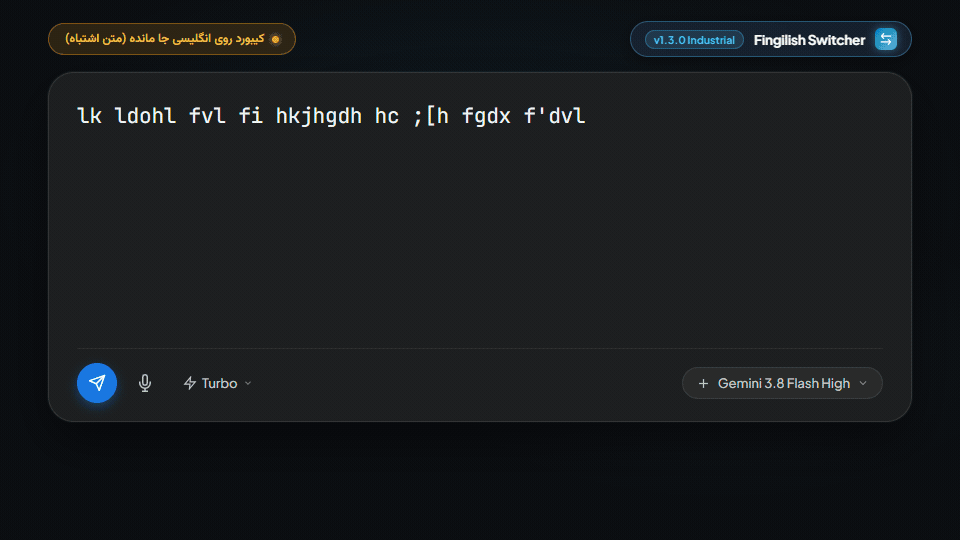

<p align="center">
  <strong>🌐 انتخاب زبان:</strong> &nbsp;
  <a href="README.md">🇺🇸 English</a> &nbsp;|&nbsp;
  <a href="README.fa.md"><strong>🇮🇷 فارسی</strong></a> &nbsp;|&nbsp;
  <a href="README.ru.md">🇷🇺 Русский</a> &nbsp;|&nbsp;
  <a href="README.es.md">🇪🇸 Español</a> &nbsp;|&nbsp;
  <a href="README.ko.md">🇰🇷 한국어</a>
</p>

<div dir="rtl">

# Fingilish Switcher — نسخه چندزبانه و هانگول (v1.5.0) ⚡
### سامانه صنعتی، فوق‌سبک، متن‌باز و ۱۰۰٪ آفلاین تبدیل آنی متون اشتباه تایپ‌شده در ویندوز

[](https://github.com/yekaweb/fingilish-switcher/releases/tag/v1.5.0)
[-38bdf8.svg)](https://github.com/yekaweb/fingilish-switcher)
[](https://github.com/yekaweb/fingilish-switcher)
[](https://github.com/yekaweb/fingilish-switcher)
[](https://github.com/yekaweb/fingilish-switcher/blob/main/inno/license.txt)

<p align="center">
  
</p>

---

## ۱. معرفی نرم‌افزار

بسیاری از اوقات هنگام تایپ در ویندوز فراموش می‌کنیم چیدمان کیبورد را تغییر دهیم (`Alt + Shift`). در نتیجه افکارمان به حروفی نامفهوم و درهم تبدیل می‌شود:
* **تایپ فارسی با کیبورد انگلیسی:** `lk ldohl fvl fi hkjhgdh hc ;[h fgdx f'dvl` ➔ **من میخام برم به انتالیا از کجا بلیط بگیرم**
* **تایپ فارسی با کیبورد انگلیسی:** `sghl phgj o,fi? lkl o,fl` ➔ **سلام حالت خوبه؟ منم خوبم**
* **تایپ کره‌ای با کیبورد انگلیسی (موتور هجا‌ساز هانگول):** `gksrnr` ➔ **한국** | `tkfkd` ➔ **사랑** | `gksrmf` ➔ **한글**
* **تایپ روسی با کیبورد انگلیسی:** `ghbdtn! rfr ltkf?` ➔ **привет! как дела?**
* **تایپ اسپانیایی:** `espa;ol` ➔ **español** | `=Como estas+` ➔ **¿Como estas¡**
* **تایپ انگلیسی با کیبورد فارسی:** `اخص شقث غخع؟هئ لخخی` ➔ **how are you?im good**

**Fingilish Switcher** یک نرم‌افزار صنعتی، مدرن و فوق‌سبک برای ویندوز ۱۰ و ۱۱ است که با فشردن یک کلید میانبر (`Ctrl + Shift + F`) یا کلیک روی دکمه شناور (`⇄`)، متن را در کسری از ثانیه در تمامی نرم‌افزارها (مرورگرها، چت‌بات‌های هوش مصنوعی، تلگرام، آفیس، ادیتورها، نوت‌پد) اصلاح و در همان محل جایگزین می‌کند.

---

## ۲. ویژگی‌های برجسته نسخه ۱.۵.۰

1. **🇰🇷 ماشین ریاضی هجا‌ساز هانگول (Hangul 2-Set Automaton):** پیاده‌سازی کامل ماشین حالت هجا‌ساز کره‌ای با ترکیب صامت‌ها، مصوت‌ها و صامت‌های پایانی (پچیم) همراه با انتقال خودکار پچیم به هجای بعدی (`gksl` ➔ `하니`) بر مبنای فرمول استاندارد یونیکد.
2. **🌐 موتور کشف داینامیک زبان‌های ویندوز (`GetKeyboardLayoutList`):** شناسایی خودکار تمامی زبان‌های فعال نصب‌شده روی ویندوز کاربر بدون نیاز به تنظیم دستی.
3. **🔄 سوییچ چرخشی چندزبانه (Cycle Morphing):** در صورت داشتن ۳ زبان یا بیشتر، با فشردن مجدد `Ctrl + Shift + F` ظرف ۳.۵ ثانیه، متن به صورت چرخشی بین زبان‌های نصب‌شده دور می‌زند (`EN ➔ RU ➔ KO ➔ FA ➔ EN`).
4. **🇷🇺 پشتیبانی از چیدمان روسی (JCUKEN) و 🇪🇸 اسپانیایی:** تبدیل دوطرفه حروف سیریلیک روسی و کاراکترهای خاص اسپانیایی (`ñ`، `¿`، `¡`).
5. **⚡ موتور کلیپ‌بورد Win32 Native:** بازنویسی کامل با توابع مستقیم Win32 بدون وابستگی به COM/STA برای عملکرد ۱۰۰٪ پایدار در کلیه نرم‌افزارها.
6. **🖱️ دکمه شناور دقیق (بدون سرقت فوکوس و بدون باگ دابل‌کلیک):** تنها هنگام انتخاب متن با درگ موس ظاهر می‌شود و با `WS_EX_NOACTIVATE` فوکوس پنجره فعال را از بین نمی‌برد.
7. **🎨 رابط کاربری صنعتی با فونت وزیرمتن (Vazirmatn):** مصرف رم کمتر از ۱۵ مگابایت، **۰.۰٪ پردازنده** در حالت آماده‌باش و ۱۰۰٪ آفلاین بدون هیچ‌گونه ثبت کلید یا تله‌متری.

---

## ۳. دانلود و نصب

آخرین نسخه بسته نصبی رسمی ۶۴ بیتی ویندوز را مستقیماً از صفحه [Releases گیت‌هاب (نسخه ۱.۵.۰)](https://github.com/yekaweb/fingilish-switcher/releases/tag/v1.5.0) دانلود و نصب کنید:
* فایل نصبی: **`FingilishSwitcher_Setup_v1.5.0.exe`**

---

## ۴. بیلد از سورس‌کد و اجرای تست‌ها

```bash
# بیلد نسخه Release
dotnet build src/FingilishSwitcher -c Release

# اجرای ۴۳ تست خودکار چندزبانه و هانگول
dotnet run --project tests/FingilishTests
```

---

## ۵. لایسنس

این پروژه تحت مجوز [MIT](inno/license.txt) منتشر شده و استفاده از آن برای اهداف شخصی و تجاری کاملاً آزاد و رایگان است.

</div>
