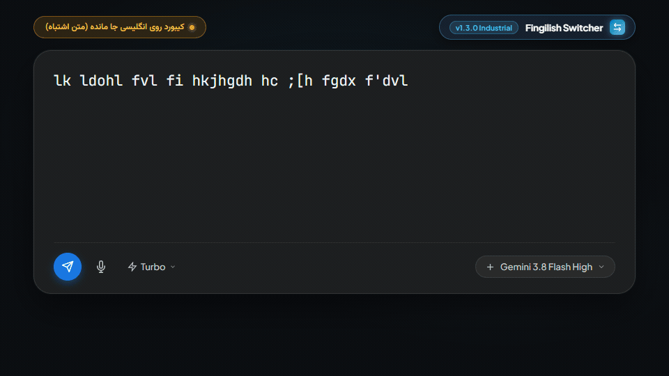

<p align="center">
  <strong>🌐 언어 선택:</strong> &nbsp;
  <a href="README.md">🇺🇸 English</a> &nbsp;|&nbsp;
  <a href="README.fa.md">🇮🇷 فارسی</a> &nbsp;|&nbsp;
  <a href="README.ru.md">🇷🇺 Русский</a> &nbsp;|&nbsp;
  <a href="README.es.md">🇪🇸 Español</a> &nbsp;|&nbsp;
  <a href="README.ko.md"><strong>🇰🇷 한국어</strong></a>
</p>

# Fingilish Switcher — 다국어 & 한글 두벌식 에디션 (v1.5.0) ⚡
### Windows용 초경량 · 100% 오프라인 · 오픈소스 한영/다국어 오타 즉시 변환기

[](https://github.com/yekaweb/fingilish-switcher/releases/tag/v1.5.0)
[-38bdf8.svg)](https://github.com/yekaweb/fingilish-switcher)
[](https://github.com/yekaweb/fingilish-switcher)
[](https://github.com/yekaweb/fingilish-switcher)
[](https://github.com/yekaweb/fingilish-switcher/blob/main/inno/license.txt)

<p align="center">
  
</p>

---

## 1. 소개

한/영 키를 누르는 것을 깜빡하고 영타로 한글을 길게 입력해 버린 경험이 있으신가요?

* **영타 ➔ 한글 (두벌식 오토마타):** `gksrnr` ➔ **한국** | `tkfkd` ➔ **사랑** | `gksrmf` ➔ **한글** | `gksl` ➔ **하니**
* **한글 ➔ 영타 (역분해):** `한국` ➔ **gksrnr** | `사랑` ➔ **tkfkd**
* **영타 ➔ 러시아어 (JCUKEN):** `ghbdtn! rfr ltkf?` ➔ **привет! как дела?**
* **영타 ➔ 스페인어:** `espa;ol` ➔ **español** | `=Como estas+` ➔ **¿Como estas¡**
* **영타 ➔ 페르시아어:** `sghl` ➔ **سلام**

**Fingilish Switcher**는 Windows 10 및 11을 위한 초경량 오픈소스 키보드 변환 도구입니다. 브라우저, AI 채팅, 텔레그램, Word, VS Code, 메모장 등 **모든 프로그램**에서 잘못 입력된 텍스트를 드래그한 뒤 **`Ctrl + Shift + F`**(또는 플로팅 버튼 **`⇄`** 클릭)만 누르면 제자리에서 즉시 올바른 언어로 변환됩니다.

---

## 2. v1.5.0 주요 기능

1. **🇰🇷 수학적 한글 두벌식 오토마타 (Hangul 2-Set Automaton):** 초성(19자), 중성(21자), 종성(28자), 겹모음/겹받침 및 모음 연음 시 받침 이동(`gksl` ➔ `하니`)까지 완벽하게 지원하는 표준 유니코드 조합/분해 엔진:
   $$\text{Syllable} = 0xAC00 + (\text{Choseong} \times 21 + \text{Jungseong}) \times 28 + \text{Jongseong}$$
2. **🌐 Windows 키보드 언어 자동 감지 (`GetKeyboardLayoutList`):** 수동 설정 없이 사용자의 Windows에 설치된 모든 입력 언어를 자동으로 인식합니다.
3. **🔄 다국어 순환 변환 (Cycle Morphing):** 3개 이상의 언어가 설치된 경우 3.5초 이내에 `Ctrl + Shift + F`를 반복 입력하여 설치된 모든 언어로 순환 변환할 수 있습니다 (`EN ➔ KO ➔ RU ➔ ES ➔ FA`).
4. **🇷🇺 러시아어 · 🇪🇸 스페인어 · 🇮🇷 페르시아어 완벽 지원:** 양방향 문자 매핑 및 특수 기호 변환 지원.
5. **⚡ 순수 Win32 네이티브 클립보드 엔진:** COM/STA 스레드 충돌 없이 모든 앱에서 즉각적이고 안정적으로 작동합니다.
6. **🖱️ 포커스 유지 플로팅 버블 (`WS_EX_NOACTIVATE`):** 마우스 드래그로 텍스트를 선택할 때만 나타나며 현재 입력창의 포커스를 절대 빼앗지 않습니다.
7. **🔒 100% 오프라인 & 개인정보 보호:** 인터넷 연결 없음, 키로깅 없음, 텔레메트리 없음. 메모리 사용량 15MB 미만 및 대기 시 **CPU 0.0%**.

---

## 3. 다운로드 및 설치

[GitHub Releases (v1.5.0)](https://github.com/yekaweb/fingilish-switcher/releases/tag/v1.5.0) 페이지에서 공식 64비트 Windows 설치 파일을 다운로드하세요:
* 설치 파일: **`FingilishSwitcher_Setup_v1.5.0.exe`**

---

## 4. 소스 코드에서 빌드하기

```bash
# Release 빌드
dotnet build src/FingilishSwitcher -c Release

# 자동화 테스트 실행 (한글 오토마타 포함 43개 테스트 통과)
dotnet run --project tests/FingilishTests
```

---

## 5. 라이선스

[MIT 라이선스](inno/license.txt)에 따라 배포되며 개인 및 상업적 용도로 완전히 무료로 사용할 수 있습니다.
