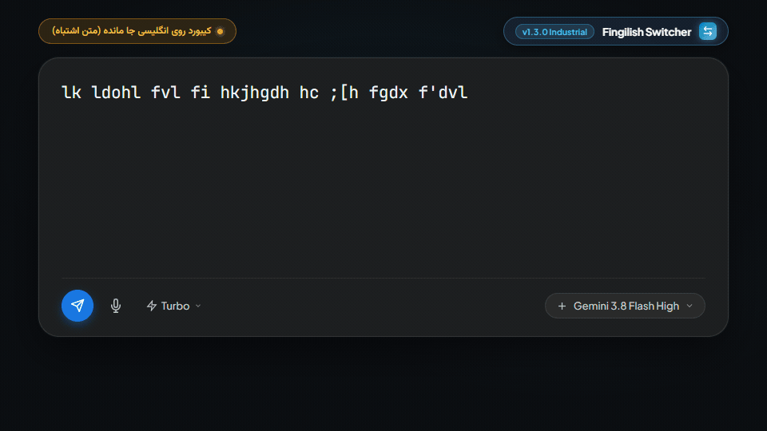

<p align="center">
  <strong>🌐 Select Language:</strong> &nbsp;
  <a href="README.md"><strong>🇺🇸 English</strong></a> &nbsp;|&nbsp;
  <a href="README.fa.md">🇮🇷 فارسی</a> &nbsp;|&nbsp;
  <a href="README.ru.md">🇷🇺 Русский</a> &nbsp;|&nbsp;
  <a href="README.es.md">🇪🇸 Español</a> &nbsp;|&nbsp;
  <a href="README.ko.md">🇰🇷 한국어</a>
</p>

# Fingilish Switcher — Polyglot & Hangul Edition ⚡
### Ultra-lightweight, open-source, 100% offline multilingual mistyped keyboard layout converter for Windows

[](https://github.com/yekaweb/fingilish-switcher/releases/tag/v1.5.0)
[-38bdf8.svg)](https://github.com/yekaweb/fingilish-switcher)
[](https://github.com/yekaweb/fingilish-switcher)
[](https://github.com/yekaweb/fingilish-switcher)
[-10b981.svg)](SECURITY.md)
[](https://www.virustotal.com/gui/file/35dc2ca2c766844023a5c5f34015f4cd23f6753684efa3809400007bb507bcc3)
[](https://github.com/yekaweb/fingilish-switcher/blob/main/inno/license.txt)

<p align="center">
  
</p>

---

## 1. Overview

Ever typed an entire sentence only to realize your keyboard was set to the wrong language (`Alt + Shift`)?

* **English ➔ Persian:** `lk ldohl fvl fi hkjhgdh hc ;[h fgdx f'dvl` ➔ **من میخام برم به انتالیا از کجا بلیط بگیرم**
* **English ➔ Korean (Hangul 2-Set Automaton):** `gksrnr` ➔ **한국** | `tkfkd` ➔ **사랑** | `gksrmf` ➔ **한글**
* **English ➔ Russian (JCUKEN):** `ghbdtn! rfr ltkf?` ➔ **привет! как дела?**
* **English ➔ Spanish:** `espa;ol` ➔ **español** | `=Como estas+` ➔ **¿Como estas¡**
* **Persian ➔ English:** `اخص شقث غخع؟هئ لخخی` ➔ **how are you?im good**

**Fingilish Switcher Polyglot & Hangul Edition** is an industrial-grade, zero-telemetry Windows utility. Select any mistyped text in **any application** (browsers, AI chats, Telegram, Word, VS Code, Notepad), press `Ctrl + Shift + F` (or click the floating `⇄` bubble), and watch it instantly morph in-place into the right language.

---

## 2. Key Features in v1.5.0

1. **🇰🇷 Mathematical Korean 2-Set Hangul Automaton:** Full state-machine syllable composer & decomposer supporting Choseong (19), Jungseong (21), Jongseong (28), compound vowels/batchim, and automatic batchim transfer (`gksl` ➔ `하니`) using the standard Unicode formula:
   $$\text{Syllable} = 0xAC00 + (\text{Choseong} \times 21 + \text{Jungseong}) \times 28 + \text{Jongseong}$$
2. **🌐 Dynamic OS Keyboard Layout Discovery (`GetKeyboardLayoutList`):** Automatically detects all active keyboard languages installed on your Windows PC — zero manual setup required.
3. **🔄 Multi-Way Cycle Morphing:** Have 3 or more languages installed? Press `Ctrl + Shift + F` again within 3.5 seconds to cycle seamlessly through all your installed layouts (`EN ➔ RU ➔ KO ➔ FA ➔ EN`).
4. **🇷🇺 Russian (JCUKEN) & 🇪🇸 Spanish Support:** Full bidirectional Cyrillic mapping and Spanish `ñ`, accents, and inverted punctuation (`¿`, `¡`).
5. **⚡ Pure Win32 Native Clipboard Engine:** Direct Win32 calls (`OpenClipboard`, `GetClipboardData`, `SetClipboardData`) with zero COM/STA threading issues across Chrome, Electron, Office, and native apps.
6. **🖱️ Focus-Safe Floating Bubble (`WS_EX_NOACTIVATE`):** Appears only on genuine mouse drag selection (no double-click annoyance) and never steals focus from your active text box.
7. **🔒 100% Offline & Privacy-First:** No internet connection, no keystroke logging, no telemetry, under 15 MB RAM, and **0.0% CPU** at idle.

---

## 3. Quick Start

1. **Download & Install** the latest official 64-bit Windows installer from [GitHub Releases (v1.5.0)](https://github.com/yekaweb/fingilish-switcher/releases/tag/v1.5.0):
   * `FingilishSwitcher_Setup_v1.5.0.exe`
2. **Convert Text Anywhere:**
   * Highlight the mistyped text in any app.
   * Press **`Ctrl + Shift + F`** (or click the floating **`⇄`** button).
   * Press again within 3.5 seconds to cycle through additional installed languages.

---

## 4. Build from Source

```bash
# Build Release binary
dotnet build src/FingilishSwitcher -c Release

# Run automated test suite (43 verified multilingual & Hangul tests)
dotnet run --project tests/FingilishTests
```

---

## 5. Security & Antivirus Verification 🛡️

* **Microsoft Defender Antivirus:** Verified 100% Clean (`0 threats found`).
* **VirusTotal:** [Public Multi-Engine Analysis Report](https://www.virustotal.com/gui/file/35dc2ca2c766844023a5c5f34015f4cd23f6753684efa3809400007bb507bcc3).
* **SHA-256 Checksum (`FingilishSwitcher_Setup_v1.5.0.exe`):**
  `35DC2CA2C766844023A5C5F34015F4CD23F6753684EFA3809400007BB507BCC3`
* Read our full [SECURITY.md](SECURITY.md) for privacy policy and zero-telemetry architecture.

---

## 6. License

Released under the [MIT License](inno/license.txt) — completely free and open-source for personal and commercial use.
