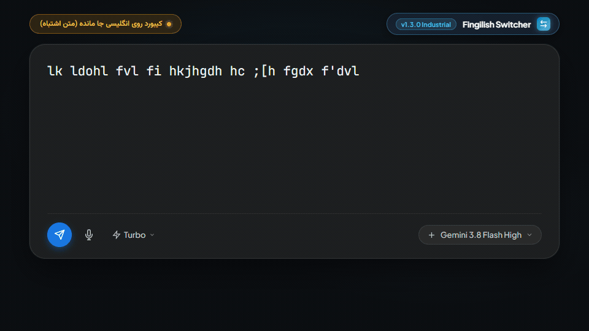

<p align="center">
  <strong>🌐 Выберите язык:</strong> &nbsp;
  <a href="README.md">🇺🇸 English</a> &nbsp;|&nbsp;
  <a href="README.fa.md">🇮🇷 فارسی</a> &nbsp;|&nbsp;
  <a href="README.ru.md"><strong>🇷🇺 Русский</strong></a> &nbsp;|&nbsp;
  <a href="README.es.md">🇪🇸 Español</a> &nbsp;|&nbsp;
  <a href="README.ko.md">🇰🇷 한국어</a>
</p>

# Fingilish Switcher — Polyglot & Hangul Edition (v1.5.0) ⚡
### Сверхлёгкий, 100% автономный и открытый конвертер ошибочной раскладки клавиатуры для Windows

[](https://github.com/yekaweb/fingilish-switcher/releases/tag/v1.5.0)
[-38bdf8.svg)](https://github.com/yekaweb/fingilish-switcher)
[](https://github.com/yekaweb/fingilish-switcher)
[](https://github.com/yekaweb/fingilish-switcher)
[](https://github.com/yekaweb/fingilish-switcher/blob/main/inno/license.txt)

<p align="center">
  
</p>

---

## 1. Описание

Знакомая ситуация: вы набрали целое предложение, забыв переключить раскладку клавиатуры (`Alt + Shift`)?

* **Английский ➔ Русский (ЙЦУКЕН):** `ghbdtn! rfr ltkf?` ➔ **привет! как дела?**
* **Русский ➔ Английский:** `руддщ цщкдв` ➔ **hello world**
* **Английский ➔ Корейский (Хангыль 2-Set):** `gksrnr` ➔ **한국** | `tkfkd` ➔ **사랑**
* **Английский ➔ Испанский:** `espa;ol` ➔ **español** | `=Como estas+` ➔ **¿Como estas¡**
* **Английский ➔ Персидский:** `sghl` ➔ **سلام**

**Fingilish Switcher** — это современная, абсолютно безопасная и открытая альтернатива устаревшим или проприетарным переключателям (таким как Punto Switcher). Выделите ошибочный текст в **любой программе** (Chrome, Telegram, Word, VS Code, Блокнот), нажмите **`Ctrl + Shift + F`** (или кликните по плавающей кнопке **`⇄`**) — и текст мгновенно исправится прямо на месте.

---

## 2. Ключевые возможности версии 1.5.0

1. **🇷🇺 Полная поддержка русской раскладки (ЙЦУКЕН):** Двустороннее преобразование всех строчных, заглавных букв и знаков препинания (`ghbdtn` ↔ `привет`, `QWERTY` ↔ `ЙЦУКЕН`).
2. **🌐 Автоопределение языков Windows (`GetKeyboardLayoutList`):** Программа сама считывает активные раскладки вашей системы — никакой ручной настройки.
3. **🔄 Циклическое переключение между несколькими языками (Cycle Morphing):** Если у вас установлено 3 и более языков, повторное нажатие `Ctrl + Shift + F` в течение 3,5 секунд циклически переключает текст по всем установленным раскладкам (`EN ➔ RU ➔ KO ➔ FA ➔ EN`).
4. **🇰🇷 Автомат слогообразования Хангыль (Корейский 2-Set):** Полноценная сборка и разборка корейских слогов по формуле Unicode (`gksrnr` ↔ `한국`).
5. **⚡ Нативный движок буфера обмена Win32:** Прямые вызовы Win32 API без проблем с потоками COM/STA — мгновенная и стабильная работа во всех приложениях.
6. **🖱️ Плавающая кнопка без перехвата фокуса (`WS_EX_NOACTIVATE`):** Появляется только при реальном выделении текста мышью и никогда не сбрасывает фокус активного окна.
7. **🔒 100% конфиденциальность и открытый исходный код:** Никакой телеметрии, никакого логирования нажатий клавиш, без доступа в интернет. Потребляет менее 15 МБ ОЗУ и **0.0% ЦП** в режиме ожидания.

---

## 3. Скачать и установить

Скачайте официальный 64-битный установщик Windows со страницы [GitHub Releases (v1.5.0)](https://github.com/yekaweb/fingilish-switcher/releases/tag/v1.5.0):
* Установщик: **`FingilishSwitcher_Setup_v1.5.0.exe`**

---

## 4. Сборка из исходного кода

```bash
# Сборка Release-версии
dotnet build src/FingilishSwitcher -c Release

# Запуск автотестов (43 пройденных теста)
dotnet run --project tests/FingilishTests
```

---

## 5. Лицензия

Распространяется под лицензией [MIT](inno/license.txt) — полностью бесплатно для личного и коммерческого использования.
