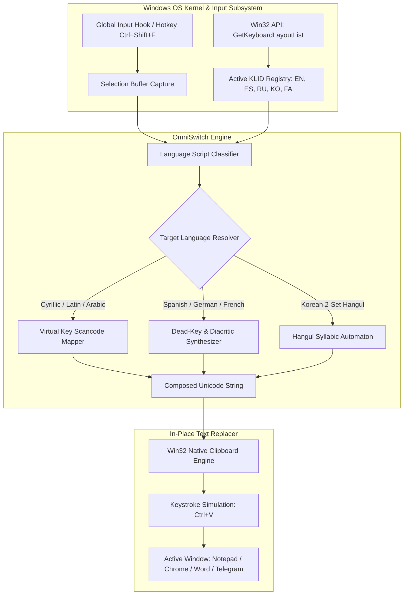

# 01 — Proposal Evaluation & Technical Architecture

## 1. Executive Summary & Core Value Proposition

**OmniSwitch Engine** (evolution of Fingilish Switcher) is an open-source, ultra-lightweight, zero-telemetry system utility that automatically detects all active keyboard layouts on the user's operating system (Windows, and future macOS/Linux) and performs seamless, in-place conversion of mistyped text across **N arbitrary languages** (e.g., English ↔ Spanish ↔ Russian ↔ Korean ↔ Persian ↔ Arabic ↔ German).

### The Problem (The Multilingual Typing Dilemma)
Multilingual users (translators, software engineers, international teams, bilingual immigrants, and content creators) frequently type sentences with the wrong input layout active:
- Typing Spanish on an English layout: missing diacritics, inverted punctuation (`¿`, `¡`, `ñ`).
- Typing Russian on QWERTY: `ghbdtn` ➔ `привет` (JCUKEN layout).
- Typing Korean on QWERTY: `gksrnr` ➔ `한국` (requires 2-Set Hangul syllable composition).
- Typing Persian on QWERTY: `sghl` ➔ `سلام`.
Existing solutions like Yandex Punto Switcher and Caramba Switcher are closed-source, limited strictly to Russian/English, infested with telemetry, or completely abandoned. There is currently **zero universal, open-source, modern desktop application** that handles dynamic N-language switching with IME syllabic automata and local privacy.

---

## 2. Investor-Ready Scoring System

| Dimension | Score (1-10) | Rationale |
|-----------|:------------:|-----------|
| **Technical Complexity** | **8 / 10** | Requires Win32 input locale enumeration (`GetKeyboardLayoutList`), Unicode dead-key handling for accented European languages, and a 2-Set Hangul composition automaton for Korean. |
| **Market / User Impact** | **9 / 10** | Multilingual desktop users account for over 1.2 billion people worldwide (Latin America, Eastern Europe, Middle East, East Asia, and polyglots). |
| **Speed to MVP** | **9 / 10** | Core Win32 clipboard engine, global hotkey registration, non-stealing floating bubble UI, and installer are already built and battle-tested in Fingilish Switcher. |
| **Defensibility / Moat** | **8 / 10** | 100% open-source trust, zero-telemetry privacy guarantee, modular layout JSON format, and Hangul syllable composition engine create high switching costs. |
| **AI Leverage** | **7 / 10** | On-device lightweight N-gram and local micro-LLM/FastText model (<2 MB) can predict intended language on ambiguous short words (e.g., words valid in both languages). |
| **Founder-Market Fit** | **9 / 10** | The codebase already features a high-performance .NET 8 WinForms core, low memory footprint (<15 MB), and verified Inno Setup distribution. |
| **Total Score** | **50 / 60** | **Tier 1 Opportunity (Exceptional Product-Market Fit)** |

---

## 3. Deep Technical Architecture



### 3.1. Dynamic OS Input Locale Discovery
Instead of hardcoding language pairs, OmniSwitch queries Windows on startup and on `WM_INPUTLANGCHANGE`:
```csharp
[DllImport("user32.dll")]
public static extern int GetKeyboardLayoutList(int nBuff, [Out] IntPtr[] lpList);

[DllImport("user32.dll")]
public static extern bool GetKeyboardLayoutName([Out] StringBuilder pwszKLID);
```
When a user has English (US: `00000409`), Spanish (`0000040A`), Russian (`00000419`), and Korean (`00000412`) installed:
1. OmniSwitch dynamically registers these 4 layouts in its active layout table.
2. If text contains Cyrillic characters, target is English.
3. If text is Latin QWERTY, the user can either cycle through installed layouts (`Ctrl + Shift + F` repeats cycle through ES ➔ RU ➔ KO) or allow the **N-Gram Perplexity Classifier** to pick the most statistically probable target.

### 3.2. Special Engine Requirements for Complex Scripts
1. **Korean 2-Set Hangul Syllable Automaton:**
   In Korean, typing Latin `gks` must compose into `한` (Initial `ㅎ` + Medial `ㅏ` + Final `ㄴ`).
   Formula: `Unicode = 0xAC00 + (Initial * 21 + Medial) * 28 + Final`.
   OmniSwitch implements a pure-math state automaton that groups sequential consonant/vowel keystrokes into precomposed Unicode blocks.
2. **Spanish & European Dead-Keys:**
   Maps single-character equivalents (`'a` ➔ `á`, `~n` ➔ `ñ`, `?` ➔ `¿`, `!` ➔ `¡`) directly into target Unicode characters without requiring multi-stage physical dead-key state machine.

---

## 4. Ten Groundbreaking 10x AI & Feature Upgrades

1. **Auto-Discovery of Active OS Locales:** Zero manual configuration; automatically senses whatever languages are enabled in Windows Language Settings.
2. **N-Gram Script Perplexity Classifier:** Micro-model (<50 KB) that runs in sub-millisecond time to detect whether QWERTY gibberish was intended as Spanish, Russian, Persian, or German based on n-gram phonetics.
3. **Hangul 2-Set Automaton:** First open-source switcher to correctly compose Korean syllables (`gksrnr` ➔ `한국`) in-place.
4. **Multi-Way Cycle-Morphing:** Pressing `Ctrl + Shift + F` repeatedly within 3 seconds cycles through all installed keyboard languages with live preview in the floating bubble.
5. **Silent Mode (Zero-Click Auto-Fix):** Optional background listener that detects obvious layout errors (e.g. typing `ghbdtn ` followed by space) and automatically backspaces and replaces without pressing any hotkey.
6. **Smart Ambiguity Disambiguation (Local SLM):** When a typed word is valid in multiple languages (e.g. `man` in English vs `من` in Persian), inspects surrounding sentence context via a 5MB quantized on-device SLM.
7. **Local-Only Privacy Seal:** 100% offline, zero internet telemetry, zero disk logging of keystrokes.
8. **Community Layout Hub (.json format):** Users can drop custom layout files into `%AppData%/OmniSwitch/layouts/` (e.g., Dvorak, Colemak, French Bepo, Ukrainian, Turkish Q/F).
9. **Instant Contextual Translation Bridge:** Pressing `Ctrl + Shift + T` converts layout AND translates to the target language via local or user-provided API key.
10. **Cross-Platform Parity:** Core architecture structured in clean modules ready for cross-compilation into macOS (InputMethodKit/Swift) and Linux (Wayland/libxdo).
