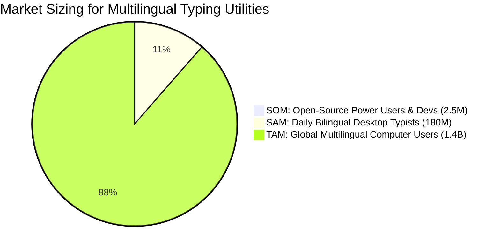

# 03 — Market, Business Model & Competitive Strategy

## 1. Total Addressable Market (TAM / SAM / SOM)



- **TAM (Total Addressable Market):** ~1.4 Billion desktop users worldwide who operate in at least two languages (Latin, Cyrillic, Perso-Arabic, CJK, and European accented alphabets).
- **SAM (Serviceable Addressable Market):** ~180 Million knowledge workers, programmers, translators, researchers, and remote workers who actively switch keyboard layouts 50+ times per day on Windows and macOS.
- **SOM (Serviceable Obtainable Market):** 2.5 Million open-source developers, privacy-conscious professionals, and polyglots attainable within 18–24 months via GitHub, Product Hunt, Reddit, and word-of-mouth.

---

## 2. Target User Personas

### Persona 1: "Soren" — The Global Software Engineer
- **Location:** Berlin / Tehran / Remote
- **Daily Stack:** English (code, GitHub, VS Code), German / Persian (Slack, Jira, family chat).
- **Core Pain:** Types variable names or comments only to find 4 lines of unreadable gibberish. Hates proprietary apps because of security audits and corporate IT restrictions.
- **Willingness to Pay:** $0 for basic utility, $29/year for team dictionary sync or local LLM context tuning.

### Persona 2: "Elena" — The Multilingual Content Creator & Translator
- **Location:** Madrid / Buenos Aires
- **Daily Stack:** Spanish (`ñ`, `á`, `¿`) and English (articles, emails, social media).
- **Core Pain:** Frequently types Spanish thoughts on US QWERTY and has to delete everything because accent marks and inverted question marks are completely wrong.
- **Willingness to Pay:** High appreciation for seamless in-place hotkey and floating button.

### Persona 3: "Min-jun" — The Academic Researcher
- **Location:** Seoul, South Korea
- **Daily Stack:** Korean (Hangul 2-Set) and English (ArXiv papers, LaTeX).
- **Core Pain:** Windows standard Korean IME often gets stuck in Latin mode, producing strings like `gksrnr` instead of `한국`. Existing Korean switchers are clunky or discontinued.

---

## 3. Monetization Strategy: Open-Core & Sponsorship

```
┌────────────────────────────────────────────────────────┐
│                   COMMUNITY EDITION                    │
│            100% Free & Open-Source (MIT)               │
│  • Dynamic OS layout detection                         │
│  • Unlimited language conversions                      │
│  • Win32 Native Clipboard & Zero-Lag Hotkey            │
│  • Floating Bubble & Vazirmatn Industrial UI           │
│  • 100% Offline, Zero Telemetry Guarantee              │
└────────────────────────────────────────────────────────┘
                           │
                           ▼
┌────────────────────────────────────────────────────────┐
│              PRO / ENTERPRISE ADD-ONS                  │
│          ($29 one-time or $3/mo team sync)             │
│  • Local Micro-SLM Contextual Auto-Fix (Silent Mode)   │
│  • In-Place Real-Time Translation Bridge (DeepL/OpenAI)│
│  • Enterprise MSIX / Group Policy Deployment Package   │
│  • Custom Organizational Glossary / Acronym Dictionary │
└────────────────────────────────────────────────────────┘
```

---

## 4. Competitive Landscape Analysis

| Feature / Metric | Punto Switcher | Caramba Switcher | LangOver | **OmniSwitch Engine** |
|------------------|:--------------:|:----------------:|:--------:|:---------------------:|
| **License** | Closed-Source | Proprietary | Freeware (Closed) | **100% Open-Source (MIT)** |
| **Privacy / Telemetry** | High Telemetry / Adware | Closed Binary | Adware Installer | **Zero Telemetry / Fully Offline** |
| **Language Support** | RU / EN Only | RU / EN / DE | RU / HE / AR / EN | **Universal N-Language (Any OS Layout)** |
| **Korean Hangul Automaton** | ❌ No | ❌ No | ❌ No | **✅ Yes (Pure Unicode Syllable Math)** |
| **Spanish / European Dead Keys** | ❌ No | Partial | Partial | **✅ Yes (Accents, `¿`, `¡`, `ñ`)** |
| **Memory / CPU Usage** | ~45 MB / 0.5% | ~25 MB / 0.2% | ~30 MB / 0.3% | **< 15 MB / 0.0% Standby CPU** |
| **Modern Industrial UI** | 90s Vintage | Headless | 2010s WinForms | **Luxury Dark Slate + Vazirmatn Typography** |

---

## 5. Go-To-Market (GTM) Strategy

1. **Step 1: Viral Dev Launch on Hacker News & Product Hunt**
   - Title: *"Show HN: OmniSwitch – A zero-telemetry, universal keyboard layout switcher that fixes mistyped text across any language"*.
   - Emphasize open-source code, safety against keylogger paranoia, and lightweight C# .NET 8 single-file binary.
2. **Step 2: Subreddit & Language Community Seeding**
   - Direct demos on r/programming, r/commandline, r/Windows11, r/korea, r/espanol, and r/russian showing exact before-and-after conversions.
3. **Step 3: Package Managers & App Stores**
   - Publish to Windows Package Manager (`winget install OmniSwitch`), Chocolatey, and Scoop for 1-click terminal installation.
