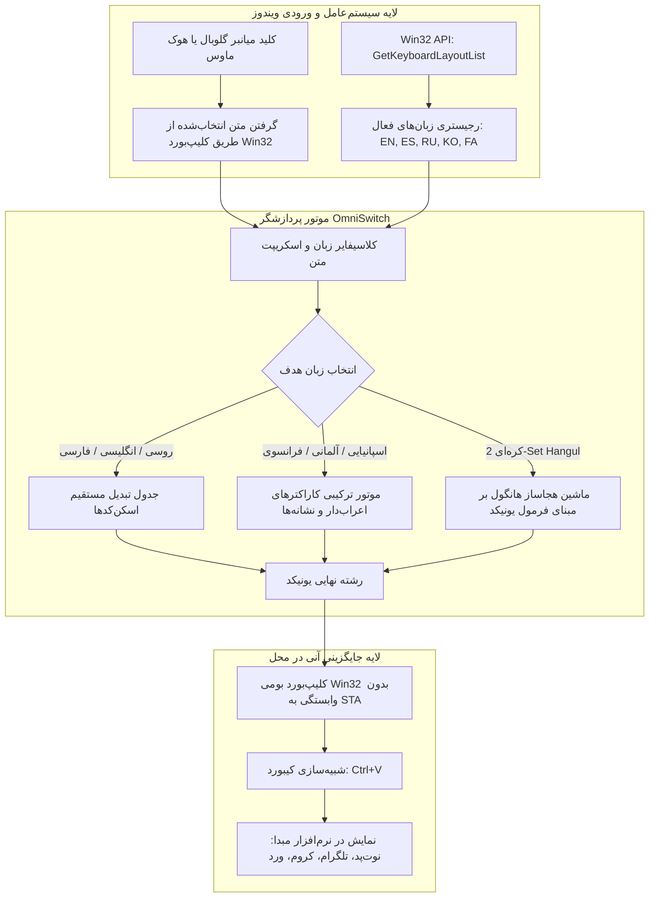

# ۰۱ — ارزیابی فنی و معماری موتور چندزبانه (OmniSwitch)

## ۱. خلاصه مدیریتی و ارزش پیشنهادی هسته (Core Value Proposition)

**موتور OmniSwitch** (تکامل و نسخه جهانی Fingilish Switcher)، یک ابزار سیستمی متن‌باز، فوق‌سبک، بدون تله‌متری و کاملاً امن برای ویندوز (و در آینده مک و لینوکس) است که به‌صورت خودکار کلیه زبان‌های فعال روی سیستم‌عامل کاربر را شناسایی کرده و تبدیل آنی و در جای متون اشتباه تایپ‌شده را میان **چندین زبان دلخواه (N زبان)** (مانند انگلیسی ↔ اسپانیایی ↔ روسی ↔ کره‌ای ↔ فارسی ↔ عربی ↔ آلمانی) انجام می‌دهد.

### مسئله اصلی (چالش تایپ چندزبانه)
کاربرانی که با دو یا چند زبان مختلف سر و کار دارند (مترجمان، برنامه‌نویسان، تیم‌های بین‌المللی، مهاجران، و تولیدکنندگان محتوا)، بارها و بارها فراموش می‌کنند چیدمان کیبورد را تغییر دهند:
- تایپ روسی روی کیبورد انگلیسی: `ghbdtn` ➔ `привет`
- تایپ کره‌ای روی کیبورد انگلیسی: `gksrnr` ➔ `한국` (نیازمند ماشین هجا‌ساز Hangul Automaton)
- تایپ اسپانیایی: کاراکترهای نشانه‌دار (`á`, `ñ`, `¿`, `¡`)
- تایپ فارسی روی انگلیسی: `sghl` ➔ `سلام`

نرم‌افزارهای قدیمی مثل Punto Switcher یا Caramba Switcher بسته و انحصاری هستند، فقط به زوج زبان روسی/انگلیسی محدودند، دارای ابزارهای جاسوسی/تله‌متری‌اند، یا سال‌هاست رها شده‌اند. در حال حاضر **هیچ ابزار مدرن، متن‌باز و سبک جهانی** وجود ندارد که چیدمان‌های فعال سیستم را خودکار بشناسد و متون چندزبانه را تبدیل کند.

---

## ۲. جدول امتیازدهی جذب سرمایه و ارزیابی ایده (Investor-Ready Scoring)

| بعد ارزیابی | امتیاز (از ۱۰) | تحلیل و دلایل |
|---|:---:|---|
| **پیچیدگی فنی (Technical Complexity)** | **۸ / ۱۰** | نیازمند کوئری به APIهای سیستمی Win32 جهت کشف لوکال‌های ورودی فعال (`GetKeyboardLayoutList`)، پردازش کلیدهای مرده (Dead-keys) زبان‌های اروپایی، و پیاده‌سازی ماشین هجا‌ساز هانگول (Hangul Syllable Automaton) برای زبان کره‌ای است. |
| **اثرگذاری بر بازار و کاربر (Market Impact)** | **۹ / ۱۰** | بیش از ۱.۲ میلیارد کاربر چندزبانه در جهان (آمریکای لاتین، اروپای شرقی، خاورمیانه، آسیای شرقی و جامعه برنامه‌نویسان) روزانه با این معضل روبرو هستند. |
| **سرعت رسیدن به MVP** | **۹ / ۱۰** | هسته اصلی شامل کپی/پیست بومی Win32، هوک ماوس، حباب شناور بدون سرقت فوکوس و اینستالر قبلاً در Fingilish Switcher ساخته شده و پایدار است. |
| **خندق رقابتی و قابلیت دفاع (Moat)** | **۸ / ۱۰** | متن‌باز بودن، تعهد ۱۰۰٪ به حفظ حریم خصوصی (عدم ذخیره لاگ کیبورد)، ساختار ماژولار JSON و پشتیبانی از هجا‌سازی کره‌ای مانع بزرگی برای رقبا ایجاد می‌کند. |
| **اهرم هوش مصنوعی (AI Leverage)** | **۷ / ۱۰** | استفاده از مدل‌های سبک کلمات N-gram و مدل محلی کم‌حجم (<2MB) جهت تشخیص هوشمند زبان در کلمات چندمعنایی و مبهم. |
| **تطابق بنیان‌گذار و پروژه (Founder Fit)** | **۹ / ۱۰** | سورس‌کد پروژه از قبل در دات‌نت ۸ با حافظه کمتر از ۱۵ مگابایت و صفر درصد پردازنده مستقر است و به سرعت قابل توسعه است. |
| **مجموع امتیاز** | **۵۰ / ۶۰** | **ایده سطح ۱ (فرصت طلایی با انطباق بالا بر نیاز بازار جهانی)** |

---

## ۳. معماری عمیق فنی (Technical Architecture)



### کشف داینامیک زبان‌های کیبورد نصب‌شده روی ویندوز
برنامه به جای هاردکد کردن زبان‌ها، در زمان اجرا لیست شناسه‌های `KLID` فعال را استخراج می‌کند:
```csharp
[DllImport("user32.dll")]
public static extern int GetKeyboardLayoutList(int nBuff, [Out] IntPtr[] lpList);
```
اگر کاربری زبان‌های انگلیسی (`00000409`)، اسپانیایی (`0000040A`)، روسی (`00000419`) و کره‌ای (`00000412`) را داشته باشد:
1. برنامه فقط بین این ۴ زبان سوییچ می‌کند.
2. با فشردن مجدد میانبر `Ctrl + Shift + F` طی ۳ ثانیه، متن بین زبان‌های نصب‌شده کاربر دور می‌زند (Cycle Switch).
3. برای کره‌ای، از فرمول ریاضی استاندارد یونیکد هانگول استفاده می‌شود:
   $$\text{Unicode} = 0xAC00 + (\text{حرف اول} \times 21 + \text{حرف میانی}) \times 28 + \text{حرف پایانی}$$
   بدین ترتیب عبارت `gks` دقیقاً تبدیل به کاراکتر ترکیبی `한` می‌شود.

---

## ۴. ده ویژگی انقلابی و هوش مصنوعی ۱۰ برابری (10x Supercharge)

۱. **کشف خودکار زبان‌های ویندوز:** بدون نیاز به تنظیم دستی؛ زبان‌های فعال سیستم‌عامل فوراً در برنامه لیست می‌شوند.  
۲. **ماشین هجا‌ساز هانگول (Hangul Automaton):** اولین ابزار متن‌باز جهان با پشتیبانی دقیق از ترکیب حروف صامت و مصوت کره‌ای درجا.  
۳. **سوییچ چرخشی میان چند زبان (Cycle Morphing):** فشردن مکرر کلید میانبر، زبان‌های فعال کاربر را یکی پس از دیگری پیش‌نمایش داده و تبدیل می‌کند.  
۴. **تشخیص آماری زبان بر مبنای N-Gram:** یک مدل فوق‌سبک آماری (کمتر از ۵۰ کیلوبایت) که زبان محتمل متن اشتباه را در چند میکروثانیه حدس می‌زند.  
۵. **حالت خاموش و خودکار (Silent Mode):** اصلاح خودکار اشتباهات فاحش بلافاصله بعد از زدن فاصله یا اینتر بدون نیاز به زدن کلید میانبر.  
۶. **رفع ابهام با هوش مصنوعی محلی (Contextual SLM):** برای کلماتی که در هر دو زبان معنا دارند، مدل سبک محلی جمله را بررسی کرده و زبان درست را برمی‌گزیند.  
۷. **امنیت و حریم خصوصی ۱۰۰٪ آفلاین:** عدم اتصال به اینترنت، عدم ارسال تله‌متری و عدم ثبت لاگ کلیدها روی دیسک.  
۸. **پشتیبانی از چیدمان‌های کاستوم (JSON Hub):** امکان اضافه کردن چیدمان‌های دلخواه (Dvorak, Colemak, ترکی F/Q) با قرار دادن فایل JSON ساده.  
۹. **پل ترجمه هوشمند:** فشردن کلید میانبر ثانویه (`Ctrl + Shift + T`) متن را همزمان هم تبدیل کیبورد و هم به زبان مقصد ترجمه می‌کند.  
۱۰. **معماری مستقل از پلتفرم:** آماده‌سازی ساختار برای بیلد روی مک‌او‌اس و لینوکس (Wayland).
